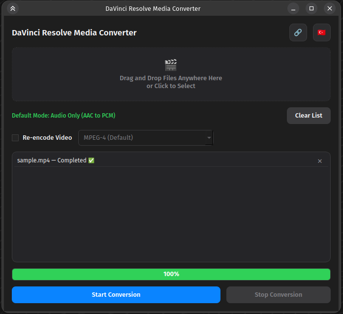

# DaVinci Resolve Media Converter (Linux)

[Türkçe](#türkçe) | [English](#english)

---

## 🇹🇷 Türkçe

Linux'ta DaVinci Resolve Ücretsiz veya Stüdyo versiyonunda desteklenmeyen AAC ses kodeği ve h264/5 video kodekleri için pratik bir grafik arayüzlü dönüştürücü.

Ücretsiz sürüm için **Videoyu yeniden kodla** seçeneğiyle MPEG-4 modunda dönüştürmeniz önerilir.

DaVinci Resolve Studio versiyonu h264/5 kodeklerini desteklese de AAC ses kodeğini desteklemiyor. Bu yüzden **Yalnızca Ses** modu ile AAC'yi PCM'e saniyeler içinde çevirebilirsiniz.

Özellikler
- Çıktılar videonun bulunduğu dizinde **./output** dizini altına depolanır.
- Video için çoklu codec Seçenekleri: MPEG-4, DNxHR LB ve DNxHR HQ modları.
- Sürükle-Bırak Desteği: Dosyaları doğrudan arayüze bırakabilme.
- Toplu Dönüştürme: Aynı anda birden fazla medyayı kuyruğa alıp işleme.
- Akıllı Hafıza (QSettings): Son seçilen ayarları ve arayüz dilini hatırlar.
- Menü Kısayolu: Tek tıkla Linux uygulama menüsüne (.desktop) entegrasyon.

Kurulum
1. FFmpeg'i sisteminize kurun (Örn: Ubuntu/Debian için `sudo apt install ffmpeg`).
2. Gerekli Python kütüphanesini yükleyin: `pip install PyQt6`
3. Uygulamaya çalıştırma yetkisi verin: `chmod +x davinci-resolve-media-converter.py`

---

## 🇬🇧 English

A practical GUI media converter for AAC audio codecs and h264/5 video codecs that are not supported in the Free or Studio versions of DaVinci Resolve on Linux.

For the Free version, it is recommended to convert using the MPEG-4 mode with the **Re-encode Video** option.

Although DaVinci Resolve Studio supports h264/5 codecs, it does not support the AAC audio codec. Therefore, you can convert AAC to PCM in seconds using the **Audio Only** mode.

Features
- Outputs are stored under the **./output** directory located in the same directory as the video.
- Multiple Codec Options: MPEG-4, DNxHR LB, and DNxHR HQ modes.
- Drag & Drop Support: Ability to drop files directly into the interface.
- Batch Conversion: Queue and process multiple media files simultaneously.
- Smart Memory (QSettings): Remembers last selected settings and interface language.
- Menu Shortcut: One-click integration into the Linux application menu (.desktop).

Installation
1. Install FFmpeg on your system (e.g., for Ubuntu/Debian `sudo apt install ffmpeg`).
2. Install the required Python library: `pip install PyQt6`
3. Grant execution permission to the application: `chmod +x davinci-resolve-media-converter.py`
